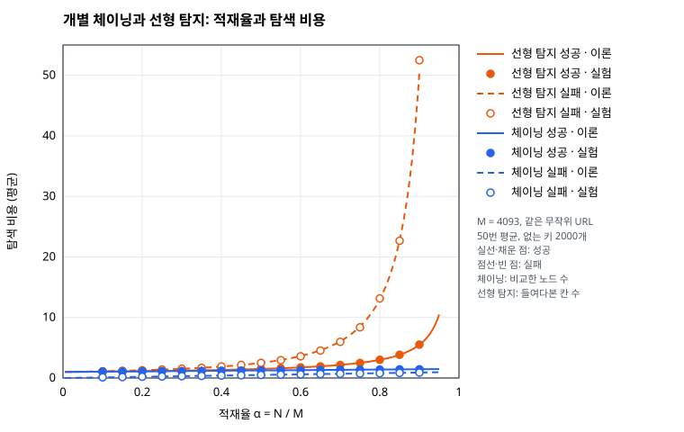
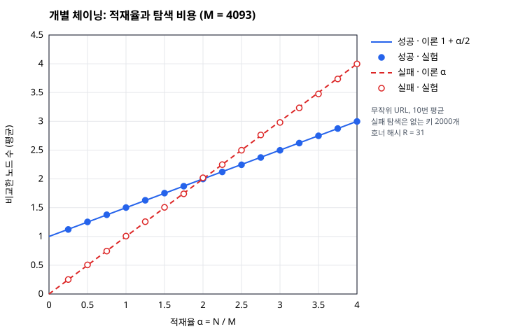

# 과제2 · 에이전트와 함께 만드는 URL 단축기

2026-2 **고급알고리즘**(SIT2001-01) 과제2 저장소입니다.
직접 구현한 해시 테이블 위에 URL 단축기를 올리고, 충돌 처리 방식 둘(개별 체이닝, 선형 탐지)을
같은 조건에서 비교합니다. [hw2-starter-2026](https://github.com/lec-algorithm/hw2-starter-2026)에서 시작했습니다.

- 과제 안내: [lec-algorithm.github.io/lecture/article/hw2-2026](https://lec-algorithm.github.io/lecture/article/hw2-2026/)
- 무엇을 만드는지: [SPEC.md](SPEC.md) · 어떤 순서로 만들었는지: [PLAN.md](PLAN.md)
- 단계별 기록: [이슈 #1~#9](../../issues?q=is%3Aissue) (#9는 검증)

## 명령

| 하고 싶은 것 | 명령 |
| --- | --- |
| 테스트 | `make test` |
| 웹 서버 (포트 8000, 개별 체이닝) | `make serve` |
| 웹 서버 (선형 탐지) | `make serve TABLE=linear` |
| 체이닝 적재율 실험 | `make experiment` |
| 체이닝과 선형 탐지 비교 실험 | `make compare` |

외부 라이브러리는 쓰지 않습니다. Python 3 표준 모듈만으로 돕니다.
서버를 띄운 뒤 브라우저에서 `/`에 URL을 넣으면 짧은 링크가 나오고, `/table`에서 해시 테이블 안을 볼 수 있습니다.
선형 탐지 화면도 `make serve TABLE=linear`로 띄운 같은 `/table`입니다. 두 방식을 나란히 보려면 한쪽을 `PORT=8001`로 띄웁니다.

충돌을 보려면 `https://www.yonsei.ac.kr`, `https://library.yonsei.ac.kr`, `https://learnus.yonsei.ac.kr`을 차례로 넣습니다 (M = 11).
앞의 둘이 6번 칸에서 만나, 체이닝은 한 리스트로 잇고 선형 탐지는 뒤의 것을 7번 칸으로, 7번이 제 칸인 셋째를 8번 칸으로 밉니다.

## 들어 있는 것

| 파일 | 하는 일 |
| --- | --- |
| `src/base62.py` | 일련번호 ↔ `0-9a-zA-Z` 62진법 문자열 |
| `src/hash_table.py` | 호너 해시 `h ← (31·h + c) mod M`, 개별 체이닝 `HashTable` |
| `src/linear_probing.py` | 선형 탐지 `LinearProbingHashTable` (같은 인터페이스) |
| `src/shortener.py` | `Shortener`: URL 검사, 코드 발급, 두 테이블 중 하나를 골라 씀 |
| `src/server.py` | `http.server` 웹 서버: 폼, 리다이렉트, `/table` 화면 |
| `tests/` | `unittest` 테스트. 같은 테스트를 두 테이블에 모두 돌림 |
| `experiments/probe_experiment.py` | 체이닝: 적재율 0.25~4의 탐색 비용 → `results.csv`, `results.svg` |
| `experiments/compare_experiment.py` | 두 방식 비교: 적재율 0.1~0.9 → `compare.csv`, `compare.svg`, `compare_log.svg` |
| `experiments/svgplot.py` | 외부 라이브러리 없이 SVG 꺾은선 그래프 그리기 |
| `.github/copilot-instructions.md` | 에이전트가 매번 읽는 저장소 규칙 |
| `CLAUDE.md` | 에이전트로 쓴 Claude Code가 위 규칙 파일을 읽게 하는 한 줄 |

`src/` 안에서는 `dict`, `set`, 내장 `hash()`를 쓰지 않습니다. `tests/test_rules.py`가 검사합니다.

## 두 테이블

| | `HashTable` (개별 체이닝) | `LinearProbingHashTable` (선형 탐지) |
| --- | --- | --- |
| 충돌한 키 | 그 칸의 연결 리스트 맨 앞에 | 다음 빈칸에 (끝 칸 다음은 0번) |
| `find`가 세는 것 | 비교한 노드 수 | 들여다본 칸 수 |
| 기본 `max_load` | 1.0 (더 크게 줘도 됨) | 0.7 (1보다 작아야 함) |
| 크기 조정 | `2M+1` 이상의 가장 작은 소수, 31의 배수 제외 | 같음 |
| `max_load=None`으로 가득 차면 | 해당 없음 | 새 키는 `OverflowError`, 탐색은 M칸 보고 끝남 |

## 같은 주소는 코드 하나

주소는 뜻이 바뀌지 않는 범위에서 한 모양으로 맞춘 뒤 저장합니다. 아래 네 주소는 모두 같은 코드를 받습니다.

```
https://Example.com      HTTPS://EXAMPLE.COM/      https://example.com:443      https://example.com/
```

스킴과 호스트의 영문 대문자는 소문자로, 기본 포트(`http`의 80, `https`의 443)는 빼고, 경로가 없으면 `/`를 붙입니다.
경로의 대소문자, 경로 끝의 `/`, 퍼센트 인코딩, 쿼리 순서는 서버마다 뜻이 다를 수 있어 건드리지 않습니다.
포트가 숫자가 아니거나 역슬래시가 든 주소처럼 읽는 쪽마다 가는 곳이 달라질 수 있는 주소는 받지 않습니다.

## 실험 결과

같은 무작위 URL을 같은 크기(M = 4093)의 두 테이블에 넣고 50번 평균을 냈습니다.
체이닝은 비교한 노드 수, 선형 탐지는 들여다본 칸 수입니다. 괄호 안은 이론값이고, ±는 50번 평균의 표준오차입니다.
선형 탐지의 이론값은 테이블이 아주 클 때의 근삿값입니다. 적재율 0.90에서 이 크기(M = 4093, N = 3684)의 정확한 기댓값은 47.6입니다
(`compare.csv`의 `probing_miss_exact`).

| 적재율 | 체이닝 성공 | 체이닝 실패 | 선형 탐지 성공 | 선형 탐지 실패 |
| --- | --- | --- | --- | --- |
| 0.10 | 1.049 (1.050) | 0.099 (0.100) | 1.054 (1.056) | 1.115 (1.117) |
| 0.50 | 1.249 (1.250) | 0.505 (0.500) | 1.498 (1.500) | 2.502 (2.500) |
| 0.75 | 1.374 (1.375) | 0.742 (0.750) | 2.484 (2.500) | 8.370 (8.500) |
| 0.90 | 1.449 (1.450) | 0.894 (0.900) | 5.516 (5.500) | 52.5 ± 2.6 (50.5) |



전체 숫자는 [experiments/compare.csv](experiments/compare.csv), 로그 눈금 그래프는
[experiments/compare_log.svg](experiments/compare_log.svg), 체이닝만 적재율 4까지 잰 것은
아래 그림에 있습니다. 시드를 고정해 다시 돌려도 같은 숫자가 나옵니다.



## Codespaces에서 휴대폰으로 열기

1. `make serve`
2. 아래쪽 패널의 포트 탭에서 8000번을 오른쪽 클릭 → Port Visibility → Public
3. Forwarded Address를 휴대폰으로 엽니다. 짧은 링크는 프록시가 넘겨준 주소(`X-Forwarded-Host`)로 만들어집니다.
4. 확인이 끝나면 Ctrl+C로 서버를 끄고 포트를 다시 Private으로 돌립니다.

## 로컬에서 하기

```sh
git clone https://github.com/hyungju07/algorithms-hw2.git
cd algorithms-hw2
docker compose up -d
docker compose exec lab bash
```

Python 3.9 이상이 있으면 컨테이너 없이 `make test`, `make serve`를 바로 돌려도 됩니다.
`compose.yml`은 포트를 내보내지 않으므로, 브라우저로 볼 때는 컨테이너 밖에서 `make serve`를 띄우거나 Codespaces를 씁니다.
